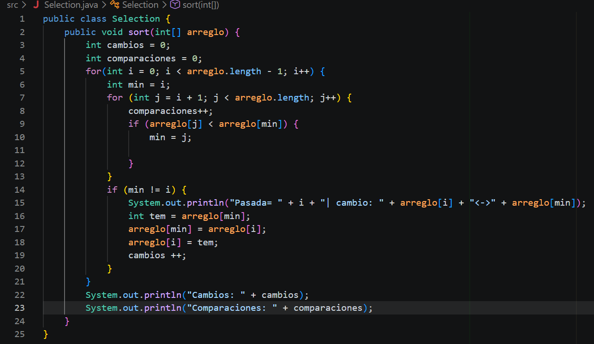
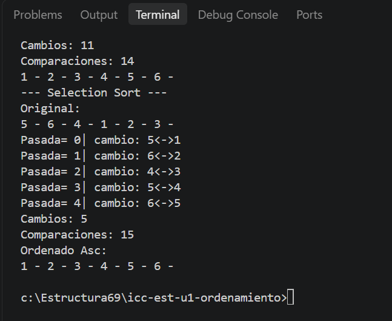

# PC 1.1.2
# 1. Captura del código del método

# 2. Explicación de cómo realizó las impresiones solicitadas
Para llegar al resultado, saqué el intercambio de números fuera del ciclo interno y sumé cambios++ dentro del if. Así corregí el ordenamiento y el programa ya pudo contar los movimientos y ordenar la lista bien.
# 3. Captura del resultado en consola
