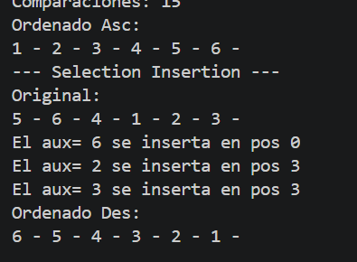

# PC 1.1.3
# 1. Captura del código del método

# 2. Explicación de cómo realizó las impresiones solicitadas
Tomo cada número y lo comparo con los de su izquierda. Si es mayor, se van a la derecha y lo inserto en su lugar, así queda ordenado de mayor a menor. Imprimo el mensaje solo cuando el número cambió de la posición.
# 3. Captura del resultado en consola
